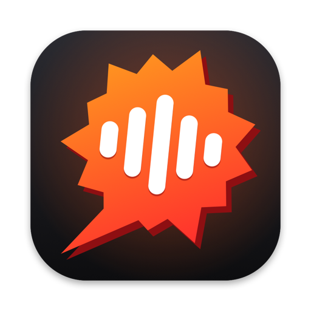
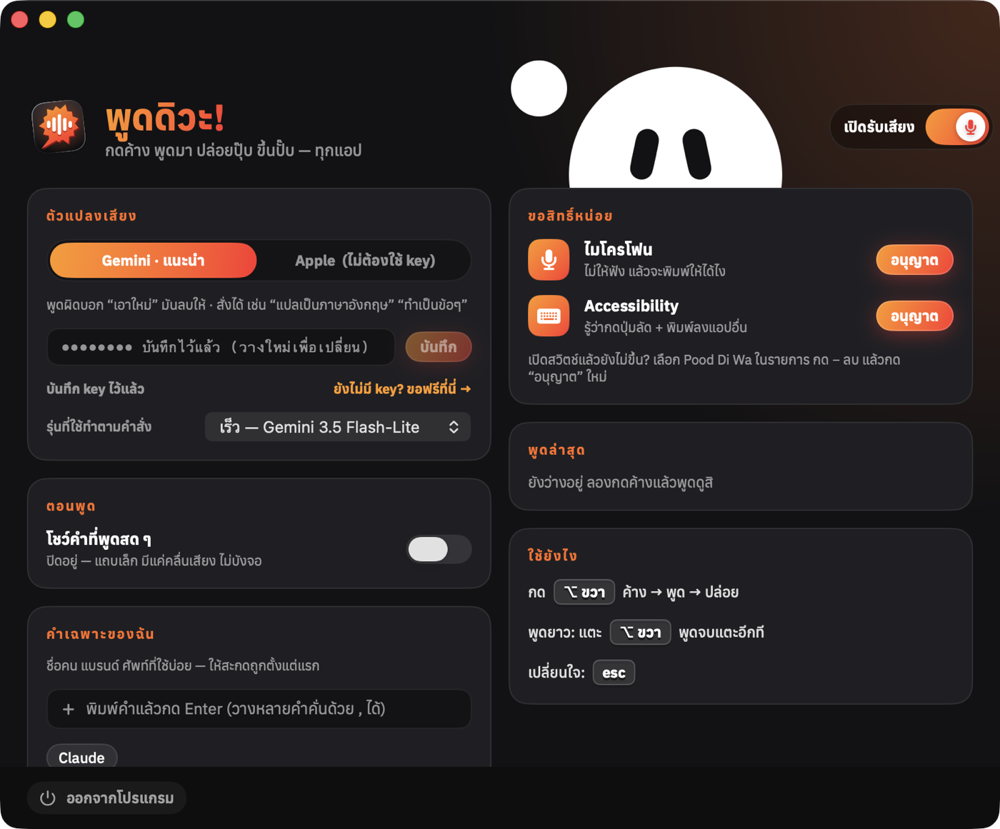

<p align="center">
  
</p>

<h1 align="center">พูดดิวะ! · Pood Di Wa</h1>

<p align="center">
  <b>กดค้าง พูดมา ปล่อยปุ๊บ ขึ้นปั๊บ — ทุกแอปบน Mac</b><br>
  Push-to-talk dictation for macOS. Hold a key, speak (Thai or English), release — the text is typed wherever your cursor is.
</p>

<p align="center">
  <a href="../../releases/latest"><b>ดาวน์โหลด DMG</b></a> · macOS 13+ · Apple Silicon &amp; Intel · MIT
</p>

<p align="center"></p>

---

## ทำอะไรได้บ้าง

- **ใช้ได้ทุกแอป** — กด **⌥ Option ขวา** ค้างไว้ พูด แล้วปล่อย ข้อความถูกพิมพ์ตรงเคอร์เซอร์
- **เร็ว** — ส่งเสียงสด ๆ ระหว่างพูดไป Gemini Live ปล่อยปุ่มแล้วได้ข้อความใน ~0.5 วินาที
- **พูดผิดบอก “เอาใหม่”** — ตัดส่วนที่พูดผิดและคำฟุ่มเฟือย (เอ่อ อ่า) ให้เอง
- **สั่งได้ด้วยเสียง** — ต่อท้ายว่า “แปลเป็นภาษาอังกฤษ”, “ทำเป็นข้อๆ”, “เขียนให้สุภาพ”
- **คำเฉพาะของฉัน** — ใส่ชื่อคน แบรนด์ ศัพท์เทคนิค ให้สะกดถูกตั้งแต่แรก
- **ประวัติ 20 ข้อความล่าสุด** — เผื่อพิมพ์ผิดช่อง คลิกเพื่อคัดลอกกลับมาใช้
- **พูดยาว** — แตะปุ่มครั้งเดียวเพื่อพูดโดยไม่ต้องกดค้าง แตะอีกครั้งเมื่อพูดจบ · `esc` = ยกเลิก
- **ไม่บังจอ** — ระหว่างพูดมีแค่แถบคลื่นเสียงเล็ก ๆ (เปิดโชว์ข้อความสดได้)
- **ไม่ใช้ key ก็ได้** — สลับไปใช้ตัวแปลงเสียงของ Apple (พื้นฐานกว่า)

## ติดตั้ง

1. ดาวน์โหลด `PoodDiWa-x.y.z.dmg` จากหน้า [Releases](../../releases/latest)
2. เปิด DMG แล้วลาก **Pood Di Wa** ไปใส่ **Applications**
3. เปิดครั้งแรกจะถูกบล็อก (แอปไม่ได้เซ็นด้วย Apple Developer ID):
   **System Settings → Privacy & Security → กด “Open Anyway”**
4. ในหน้าต่างพูดดิวะ: ให้สิทธิ์ **ไมโครโฟน** และ **Accessibility**
5. ใส่ **Gemini API key** — ขอฟรีที่ [Google AI Studio](https://aistudio.google.com/apikey)
   (แต่ละคนใช้ key ของตัวเอง)

> หลังอัปเดตแอป ถ้าเปิดสวิตช์ Accessibility แล้วยังไม่ติด ให้ลบ Pood Di Wa ออกจากรายการด้วยปุ่ม − แล้วกดอนุญาตใหม่

## ค่าใช้จ่ายและความเป็นส่วนตัว

- **ฟรีเทียร์ของ Gemini ใช้ได้ฟรี** แต่ตามเงื่อนไขของ Google ข้อมูลในฟรีเทียร์ (รวมเสียงที่พูด) **อาจถูกใช้ปรับปรุงบริการของ Google**
  ถ้าจะพูดเรื่องลับ ให้เปิด billing ในบัญชี Google (แบบเสียเงิน Google ไม่เอาข้อมูลไปใช้)
- แบบเสียเงิน: ตัวถอดเสียงสด ≈ $0.009/นาที (ราคาตามหน้า Pricing ของ Google ณ พ.ย. 2026)
- API key เก็บในเครื่องที่ `~/Library/Application Support/PoodDiWa` (อ่านได้เฉพาะผู้ใช้) ไม่ถูกส่งไปที่อื่นนอกจาก Google
- ประวัติข้อความเก็บในเครื่องเท่านั้น · Log ข้อผิดพลาด: `~/Library/Logs/PoodDiWa.log` (ไม่มี key และไม่มีข้อความที่พูด)

## วิธีทำงาน (สำหรับนักพัฒนา)

```
ไมค์ ─► PCM 16 kHz ─┬─► Gemini Live (SMART)    → ข้อความเรียบร้อย  ─┐
                    └─► Gemini Live (VERBATIM) → คำต่อคำ (จับคำสั่ง) ─┴─► มีคำสั่ง/ผลแปลก? ─► Flash-Lite เรียบเรียง ─► ⌘V
```

- เปิด WebSocket 2 สายไป `gemini-3.5-transcribe-live` พร้อมกัน — SMART ให้ข้อความสะอาด, VERBATIM ไว้จับคำสั่งที่ SMART ตัดทิ้ง
- คำเฉพาะส่งให้สาย VERBATIM เท่านั้น (ถ้าส่งให้ SMART มันตัดครึ่งแรกของประโยคทิ้ง — ทดสอบแล้ว)
- ขั้นเรียบเรียงยิง 2 endpoint พร้อมกัน ใช้อันที่ตอบก่อน เพราะเซิร์ฟเวอร์ตอบช้าเป็นพัก ๆ
- ถ้า Live เชื่อมต่อไม่ได้ จะส่งเสียงทั้งก้อนเป็นไฟล์แทนอัตโนมัติ
- พิมพ์ลงแอปด้วยการวางผ่านคลิปบอร์ด (⌘V) แล้วคืนคลิปบอร์ดเดิมให้

### Build

ต้องมีแค่ Xcode Command Line Tools (`xcode-select --install`)

```bash
./build.sh            # → build/Pood Di Wa.app + dist/PoodDiWa-<version>.dmg (Universal)
./build.sh --no-dmg   # เฉพาะ .app
swift scripts/make_art.swift build/art   # วาดไอคอน + พื้นหลัง DMG ใหม่
```

เปลี่ยนเวอร์ชันที่ `CFBundleShortVersionString` ใน `Resources/Info.plist`

### โหมดทดสอบ

```bash
APP="/Applications/Pood Di Wa.app/Contents/MacOS/PoodDiWa"
"$APP" --selftest clip.wav --vocab "Claude,CapCut"   # สตรีม WAV (16 kHz mono) ไป Gemini Live แล้วพิมพ์ผล
"$APP" --bench-refine                                # วัดความเร็วขั้นเรียบเรียง
"$APP" --hud-preview --text                          # พรีวิวแถบตอนพูด
```

### โครงสร้าง

| ไฟล์ | หน้าที่ |
|---|---|
| `Sources/AppDelegate.swift` | แถบเมนู, state machine ของปุ่มลัด, ส่งข้อความ |
| `Sources/LiveTranscriber.swift` | อัดเสียง + WebSocket ไป Gemini Live 2 สาย |
| `Sources/GeminiClient.swift` | prompt, ขั้นเรียบเรียง, ส่งแบบไฟล์ (fallback) |
| `Sources/HotkeyMonitor.swift` | ฟังปุ่ม modifier ทั้งระบบ |
| `Sources/TextInserter.swift` | วางข้อความลงแอปที่โฟกัสอยู่ |
| `Sources/Onboarding.swift`, `Mascot.swift`, `HUD.swift` | หน้าตั้งค่า, มาสคอต, แถบตอนพูด |

## License

- โค้ด: [MIT](LICENSE)
- ฟอนต์ [Anuphan](https://github.com/cadsondemak/Anuphan) โดย Cadson Demak: [SIL Open Font License 1.1](Resources/Fonts/OFL.txt)
